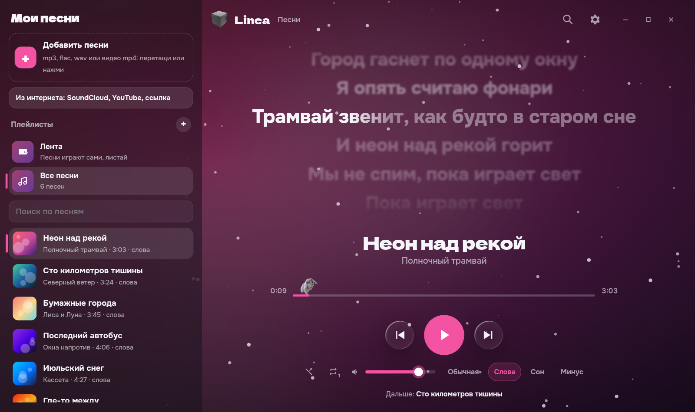

# Linea

Плеер, в котором слова идут вместе с музыкой: строка загорается, когда её поют, а слоги заливаются цветом прямо под голос. Для Windows и Android.

## Что умеет

- **Слова под музыку.** Linea сама находит слова на lrclib и подсвечивает их по строкам и слогам. Нашёлся только текст без времени — расставит строки по звуку и честно пометит «примерно». Где-то разошлось — поправишь пробелом прямо на ходу.
- **Свои файлы и интернет.** mp3, flac, wav и даже клипы mp4 — видео уходит на фон. Песни и целые плейлисты с SoundCloud и YouTube по ссылке, а на телефоне через «Поделиться». Есть «Лента»: песни играют сами, понравилась — сердечко.
- **Красиво.** Фон из обложки, свои картинки или переливающийся градиент, жидкое стекло, снег или пылинки, бас качает обложку. Компьютер или телефон не тянет — Linea заметит это сама и упростит эффекты, музыку это не трогает.
- **Звук.** Эквалайзер (обычный, бас, голос, ночь), выравнивание громкости, плавные переходы, sped up и slowed, таймер сна. На ПК есть «Минус»: нейросеть убирает голос, и петь можешь ты.
- **На ПК.** Слова поверх игр, клавиши, которые работают даже в играх, медиаклавиши и плашка Windows, трей, статус «Слушает» в Discord.
- **На Android.** Плеер в шторке и на экране блокировки, виджет на главный экран, «Поделиться → Linea» из SoundCloud и YouTube.
- **Last.fm.** Отмечает прослушанное по его правилам: после половины трека или четырёх минут.
- **Перенос.** Песни, плейлисты и слова с правками — одним файлом .linea: сохранил на компьютере, открыл на телефоне. Добавится только то, чего там ещё нет.
- **Обновления сами.** Linea следит за новыми версиями и предлагает обновиться.

## Скачать

- **Windows** — [последний релиз](https://github.com/Airi-Drun-System/Linea/releases/latest). `Linea-…-setup.exe` ставится и дальше обновляется сама, `Linea-…-portable.exe` работает без установки, но новые версии придётся скачивать вручную.
- **Android** — [Linea-android.apk](https://github.com/Airi-Drun-System/Linea/releases/download/android/Linea-android.apk). Новая версия встаёт поверх старой, ничего не теряется.

### Windows пишет «Windows защитил ваш компьютер»

Так SmartScreen встречает программы без платной подписи: он просто ещё не знает Linea. Нажми «Подробнее», потом «Выполнить в любом случае».

### Android не даёт установить

APK скачан не из Google Play, поэтому Android спросит разрешение. Открой «Настройки» из его окна, включи «Разрешить установку из этого источника» для браузера или Telegram и вернись к установке. Если Play Защита скажет, что приложение не проверено, нажми «Всё равно установить» (на некоторых телефонах сначала «Подробнее»).

## Честно

Музыка с SoundCloud и YouTube играет через их официальные плееры, так же как на самих сайтах. Linea ничего не скачивает и не вытаскивает звук в обход. Свои файлы никуда не загружаются: библиотека живёт на твоём компьютере или телефоне, «Минус» и разметка слов считаются там же.

## Автор

Vegas · VegasDev. Новости и анонсы Linea — в Telegram: [t.me/CabbitJumpNews](https://t.me/CabbitJumpNews).

Нашёл баг или есть идея — пиши в [Issues](https://github.com/Airi-Drun-System/Linea/issues). Проще всего прямо из Linea: «Настройки → О Linea → Сообщить о баге», версия подставится сама.
